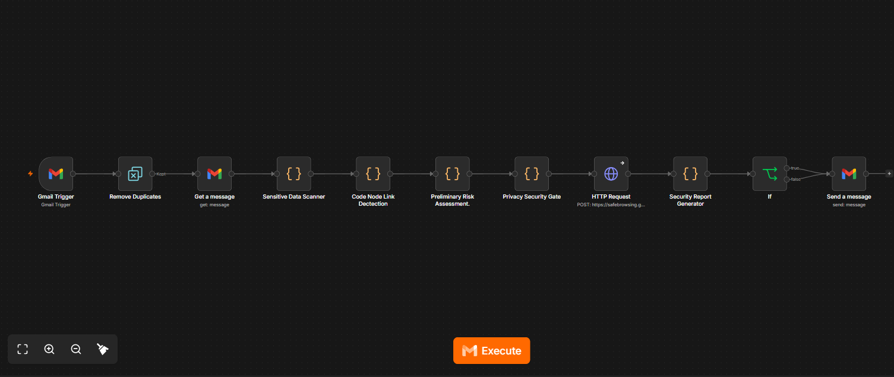

# SentinelAI — Automated Email Threat Detection

I developed SentinelAI using **n8n, JavaScript, Gmail, and Google Safe Browsing** to automate email security checks and generate security reports.

## 1. System Architecture

I built an 11-node n8n workflow that monitors incoming emails, scans for suspicious phrases and URLs, performs preliminary privacy checks, and sends security reports.

## 2. Key Features

- Automated Gmail monitoring and duplicate detection
- Suspicious phrase detection and URL extraction
- Google Safe Browsing URL reputation checks
- JavaScript-based preliminary risk and privacy assessments
- Automated security reports with recommendations

## 3. Technologies Used

| Technology | Purpose |
|---|---|
| n8n | Workflow automation |
| JavaScript | Security checks and reporting |
| Gmail | Email processing and report delivery |
| Google Safe Browsing | URL reputation checks |
| JSON | Workflow data and API requests |

## 4. Testing Results

I tested SentinelAI using normal and simulated suspicious emails.

| Test | Risk | Links | Indicators | Result |
|---|---|---|---|---|
| Normal Email | Low | 0 | 0 | Report delivered |
| Suspicious Email | High | 1 | 2 | Report delivered |

The suspicious test used a harmless `.invalid` URL. Google Safe Browsing returned no known matches.

## 5. Security Report Examples

These illustrated examples show my workflow's Low-risk and High-risk report formats.

## 6. Security and Privacy

I added preliminary sensitive-data scanning and privacy checks, and kept external AI analysis disabled.

## 7. Challenges and Lessons Learned

I improved my JavaScript and troubleshooting skills while integrating Google Safe Browsing and testing different email scenarios.

## 8. Future Improvements

I plan to improve phishing detection, add sender authentication checks, and build a security monitoring dashboard.

## 9. Project Status

**Working Prototype** — I built and tested automated email threat assessment and reporting.

## 10. Workflow File

[View My SentinelAI Workflow](SentinelAI%20n8n.json)

The workflow can be imported into n8n and configured with the user's own credentials. Review and remove any personal information or secrets before reusing or sharing the file.

---

**Disclaimer:** SentinelAI is an educational cybersecurity project that provides preliminary security assessments.
